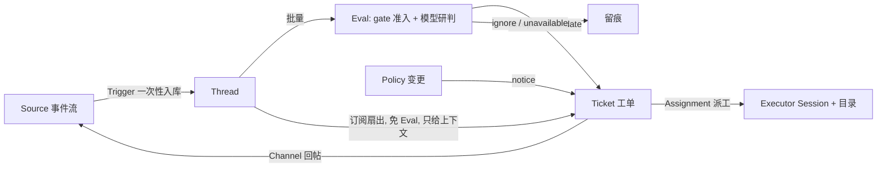

# dsh-superagent（中文摘要版）

> 研究原型，仅供参考，不是 DeepSeek 官方产品（英文原声明见 [README.md](README.md)）。本页是基于 [docs/](docs/) 000–008 的阅读整理；权威内容以编号文档为准。

## 一句话定位

面向**单个 GitHub 仓库**的主动型 coding agent，作为 DeepSeek Harness（DSH）的 bundle 运行：监听 GitHub（可选飞书），允许名单里的人 @ 它提出请求；请求经 Policy/Eval 判定后成为工单，每个工单在独立的 DSH Session 和独立目录里干活，产出回到原对话（PR、评论、答复）；Web 面板只展示需要人处理的事。

## 核心哲学（docs/000）

**占用人的注意力最少，给出价值最大。** 只在被请求或团队写的规则允许时行动；只在"人必须行动或能用上结果"时说话；确认一次、干活安静、提问一次一个具体问题。默认从窄名单 + `observe` 模式起步（只记录"本应接单"，不真接）。

## 核心流程（docs/001–003）



关键纪律：

- **授权是代码强制的**：消息、评论、引用文档只是研判输入，不能改权限；模型无权改 gate、名单、工具校验。
- **每条消息默认一句话**（硬上限 100 词），路由注记 ≤30 词。
- **先落盘再执行**：所有状态在 Store（sqlite），崩溃/重启按留痕恢复，重启带 recovery note。
- 工单是持久单元：后续评论不用重新 @ 也能扇出进同一个工单；被停止的工单不再接收任何东西，只有人的 stop 能撤回 Mandate。

## 运行时架构（docs/007）

```text
外部世界                     DSH profile 进程（加载了插件的那个 DSH 实例）
┌─────────┐
│ GitHub  │  notifications 轮询    ┌──────────────────────────────────────────┐
│ Feishu  │ ─────────────────────▶ │ Source 插件（github-watch / feishu-watch） │
└─────────┘  事件→Trigger           │ 过滤、去重、记读位置；注入 orchestrator    │
                                  └───────────────┬────────────────────────────┘
                                  receive(trigger)▼（存一次/duplicate/filtered）
                                  ┌──────────────────────────────────────────────┐
                                  │              Engine（唯一写入者）              │
                                  │ Intake · Evals · Tickets · Assignments · Replies │
                                  └──────┬─────────────────┬─────────────────┬────┘
                Policy ──────────────────┘   MasterAssessor │ DshExecutor    │ Outbox
        (gate/revalidate/版本哈希)      (研判→Decision) (每工单 Session+目录) (先落盘 receipt
                                        ▲                ▲  prepare 命令       再发送→回原对话)
  Passes（心跳：每 2s 跑到期效应与 evaluateDue）─────────┘                │
  主 Session（router 工具）／Executor Session（worker 工具）／面板+API ───┘
                                  ┌──────────────────────────────────────────────┐
                                  │ Store（<stateDir>/orchestrator.sqlite）        │
                                  └──────────────────────────────────────────────┘
  DSH 运行时底座（被插件借用）：Session 创建/恢复 + worker/router preset、工具、schedule、
  subprocess service（setup 探测 CLI、写 worker-bin/worker-gitconfig）、skills、模型 provider
```

调用方只拿到自己角色的 Engine 切片（EngineForSources / ForMainSession / ForPeople / ForSettings / ForExecutor）。

## 怎么跑

前置：Node 22.19+/24+、pnpm、git 2.32+、tmux、Python 3.8+、GitHub CLI 2.48+、DSH 在 `engines.dsh`（`^0.2.1-alpha.2`）、配好的模型 provider、github.com 仓库（不支持 GHES）。

```sh
npm install -g @deepseek-ai/dsh@0.2.1-rc.3
git clone <repo> dsh-superagent && cd dsh-superagent
pnpm install && pnpm build
dsh superagent --from-default-profile web --dump-config > /dev/null  # 只在首次！重复会删 profile 的 cordis.patch.yml
dsh plugin --profile superagent add "link:$PWD"
```

然后：把 [examples/profile.cordis.patch.yml](examples/profile.cordis.patch.yml) 填入 `stateDir`（必填绝对路径），配 `gh` 包装器（只登 agent 账号），面板里按 **Sources → Policy → Execution → Prompts** 保存，用 `scripts/dsh-superagent start` 启动（tmux 会话），打开面板选 **Superagent**。

日常用法：允许名单里的账号在仓库 Issue 发一条**新评论** `@<agent登录名> <请求>`（编辑已有正文里的 @ 不算），约 1 分钟内出现工单。

`status` 退出码：0 正常 / 1 未运行（可重启修复）/ 2 组件错误（重启修不了）/ 3 等待 setup。每小时检查要建在**操作员自己的 profile**（它必须比服务活得久）。

## 常见误区（本次讨论沉淀）

1. **它不是与 DSH 无关的独立服务**——它本身就是 DSH bundle（peerDependencies 全是 `@deepseek-ai/dsh-*`）；"独立"仅指它跑在独立 profile 进程里。两个 DSH 实例（你日常的 3080 与它的 3082）之间没有远程挂载机制，本机 GUI 不能直接"用"远端 superagent。
2. **面板与 Management API 只接受 `127.0.0.1` / `localhost`**，缺 `x-orchestrator-request: 1` 或来自别的 Origin 一律 403。远程监管靠 SSH 隧道（`ssh -L 3082:127.0.0.1:3082`）或 WSL 的 localhost 转发；不要把它直接暴露到局域网（无鉴权）。
3. **功能上和 claude bot / grok bot 同类**（被 @ 触发的 GitHub bot）。差异是形态与纪律：账号型（读 notifications，GitHub App 不可用）而非 App+webhook；自托管常驻进程；持久工单 + 可审计 Mandate + 噪音管理。单人单仓库场景这些优势基本用不上。
4. **脚本是 Unix-only**：`scripts/dsh-superagent` 依赖 tmux、`ps`、`fcntl`，Windows 原生不可运行，需 WSL 或 Linux。
5. **安全边界要诚实**：worker 以操作员 OS 用户跑 `danger-full-access`；CLI 包装器只是默认身份不是隔离。要隔离就用只含 agent 凭据的专用 OS 账号。

## 文档索引（按序读，每篇只依赖前面）

| 文档 | 内容 |
|---|---|
| [000](docs/000-philosophy.md) | 哲学与操作员责任 |
| [001](docs/001-domain.md) | 领域模型与术语表（含中英文对照） |
| [002](docs/002-authorization.md) | gate、准入表、strength、accept mode、Mandate 再验证 |
| [003](docs/003-execution.md) | 工单阶段、Executor、并发、失败与恢复 |
| [004](docs/004-prompts.md) | 团队段、内置段覆盖、装配顺序与优先级 |
| [005](docs/005-panel.md) | 面板六页与三个问题 |
| [006](docs/006-deployment.md) | 安装、机器配置、启停、Management API、升级、排障 |
| [007](docs/007-architecture.md) | 类与模块索引（Engine 五部分、ports） |
| [008](docs/008-cookbook.md) | 加一个新 Source 的 11 步 recipe |

开发校验：`pnpm check`。License：[MIT](LICENSE)。
